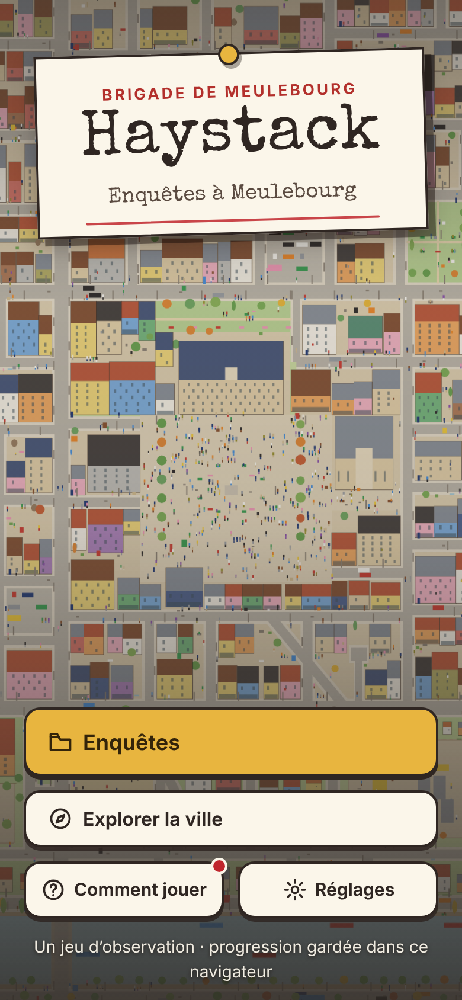
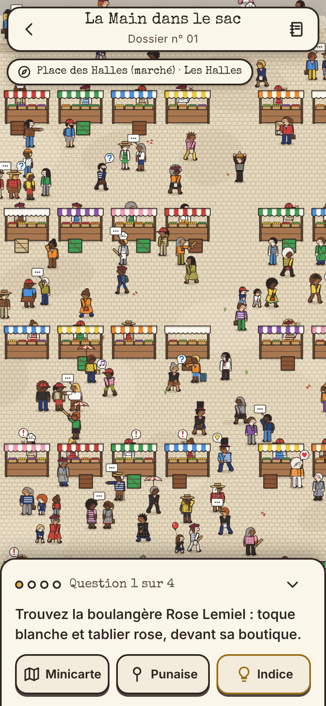
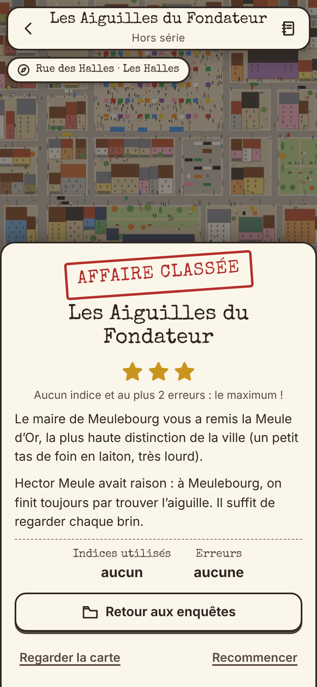
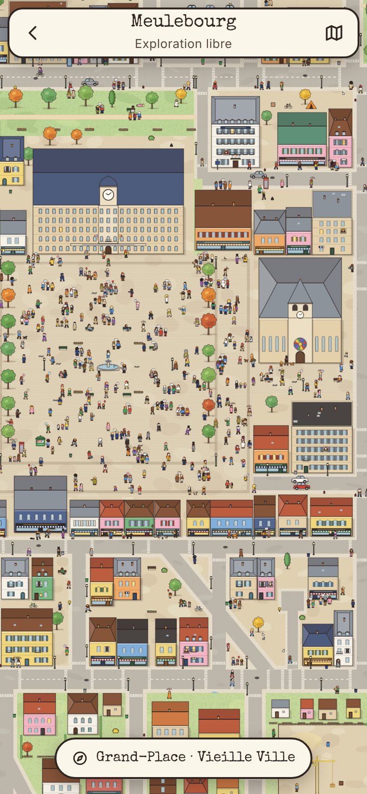

# Haystack

Jeu d'enquête **web, pensé pour le téléphone** : on explore la grande carte illustrée de la ville de
**Meulebourg**, on y repère personnages, objets et lieux, et l'on résout des affaires en les désignant du doigt.
Chaque enquête pose une série de questions (« Trouvez la boulangère… », « Où s'est-il réfugié ? », « Qui a… ? ») dont
la réponse est quelque part dans la foule : un même personnage apparaît plusieurs fois, à des moments différents
de son histoire, et un fil rouge relie vos trouvailles. Sept enquêtes, du tutoriel à l'affaire la plus ardue,
sans compte, sans installation, sans serveur : la progression reste dans le navigateur.

*Projet récréatif, entre amis. Ville, personnages, enquêtes et interface sont générés ou écrits avec Claude Code
(un orchestrateur et des sous-agents) ; le journal de bord raconte la fabrication.*

<table>
  <tr>
    <td align="center" width="25%"></td>
    <td align="center" width="25%"></td>
    <td align="center" width="25%"></td>
    <td align="center" width="25%"></td>
  </tr>
  <tr>
    <td align="center"><sub>L'accueil</sub></td>
    <td align="center"><sub>Une enquête en cours</sub></td>
    <td align="center"><sub>Affaire classée</sub></td>
    <td align="center"><sub>Explorer la ville</sub></td>
  </tr>
</table>

> Plan : [`docs/PLAN-WEB.md`](docs/PLAN-WEB.md) · Journal de bord : [`docs/JOURNAL.md`](docs/JOURNAL.md) ·
> Architecture : [`docs/ARCHITECTURE.md`](docs/ARCHITECTURE.md) · Bible des enquêtes :
> [`docs/CONTENT.md`](docs/CONTENT.md) (**contient toutes les solutions**)

## Comment on joue

L'écran « Comment jouer » du jeu résume l'essentiel en quatre étapes ; en voici le détail.

- **Se déplacer.** Pincez pour zoomer, glissez pour vous déplacer, double tap pour rapprocher la vue (à l'ordinateur :
  molette, glisser à la souris, clavier). Une pastille en haut à gauche donne le nom du lieu ou de la rue sous le centre de
  l'écran, et la **minicarte** (bouton du bas) montre toute la ville, ses quartiers et la zone visible : touchez-la pour
  vous y rendre.
- **Désigner.** Chaque question demande une personne, un objet ou un lieu. Touchez-le : une vignette montre ce que le jeu
  a retenu, puis « Désigner » valide (si la carte est trop dézoomée, le jeu vous rapproche d'abord).
  Une **fausse piste** (« Pas tout à fait… ») vous oriente sans rien coûter ; une **erreur** compte, mais jusqu'à deux
  erreurs rien n'est perdu.
- **Suivre un personnage.** Une bonne réponse raconte la suite de l'histoire et déverrouille la question suivante.
  Les personnages se retrouvent d'une scène à l'autre : repérez leurs vêtements, un **fil rouge** relie ce que vous avez
  trouvé. Certaines affaires ouvrent plusieurs pistes en parallèle (onglets au-dessus de la question).
- **Indices.** Bloqué ? Un indice se paie en étoiles, le jeu annonce son coût avant de le donner. Niveau 1 : un conseil
  écrit. Niveau 2 : une zone de la carte est éclairée au projecteur. Niveau 3 : la réponse est montrée.
- **Étoiles.** ★★★ : aucun indice et au plus 2 erreurs. ★★ : pas de réponse révélée, en moyenne au plus un niveau d'indice
  par question, au plus 6 erreurs. ★ sinon. L'écran de fin dit pourquoi vous avez cette note ; « Recommencer » garde votre
  meilleur résultat.
- **Carnet, punaises, notes.** Le carnet (en haut à droite) garde le briefing, les questions résolues (avec « Voir » pour
  retourner sur la scène), les personnages identifiés, vos notes et vos **punaises** : posez-en sur la carte pour marquer un
  suspect ou un endroit à revoir.
- **Réglages.** Vibrations, mode gaucher (les boutons d'action changent de côté), mouvement réduit (également respecté
  quand le système le demande), réinitialisation de la progression.

L'accueil propose aussi **Explorer la ville** : la carte en liberté, sans question, pour flâner dans Meulebourg.

## Les sept enquêtes

Chaque affaire débloque la suivante ; le hors-série s'ouvre dès le tutoriel terminé. Difficulté de 1 (facile) à 5 (ardue).

| N° | Enquête | Diff. | Accroche |
|---|---|---|---|
| 00 | **La Tarte de bienvenue** (tutoriel) | 1 | Premier jour à la brigade : une tarte aux fraises s’est volatilisée entre la boulangerie et le commissariat. |
| 01 | **La Main dans le sac** | 1 | Jour de marché aux Halles : la caisse de la boulangerie s’est envolée. Le voleur n’est pas très discret. |
| 02 | **Coin-coin !** | 2 | Au Parc des Meules, la cane dorée de la baronne a disparu le jour du grand concours. |
| 03 | **La Belle Évasion** | 3 | Un détenu s’est fait la belle devant la gare, en pyjama rayé. Il ne devrait pas aller bien loin, sauf si quelqu’un l’attend. |
| 04 | **La Grande Paille** | 4 | Le diamant le plus célèbre de Meulebourg a disparu de la bijouterie Carat. Tout le monde a menti, même le diamant. |
| 05 | **Rideau !** | 5 | Première au Théâtre de la Botte : la diva s’effondre à l’entracte. Trois comédiens, un costume, un assassin. |
| — | **Les Aiguilles du Fondateur** (hors série) | 3 | Dix aiguilles d’or, perdues il y a deux siècles par le fondateur de Meulebourg. La botte de foin, c’est la ville entière. |

## Lancer en local

Node 22 (celui du workflow de mise en ligne) et npm.

```bash
npm install
npm run dev        # puis ouvrir l'URL affichée ; « Network » = accessible depuis un téléphone du même réseau
```

`npm run build` produit la version de production dans `dist/` (le typage est vérifié d'abord) et `npm run preview` la sert
localement. Pages de développement, servies par `npm run dev` mais non publiées : `/dev/map.html` (carte brute),
`/dev/gallery.html` (catalogue graphique), `/dev/overview.html` (plan de la ville), `/tools/content/preview.html`
(scènes des enquêtes).

Paramètres d'URL utiles : `?debug` (expose `window.__haystack`, affiche les coordonnées), `?ui=0` (carte seule),
`?x=…&y=…&zoom=…` (caméra initiale), `?case=c01` (ouvre une enquête, même verrouillée), `?screen=explorer`
(`accueil`, `dossiers`, `regles`, `reglages`, `explorer`).

## Mise en ligne (GitHub Pages)

Le workflow [`.github/workflows/pages.yml`](.github/workflows/pages.yml) publie le jeu **à chaque push sur `main`**
(ou à la demande depuis l'onglet Actions) : installation (`npm ci`), `npm run typecheck`, `npm test`, `npm run build`,
puis déploiement du dossier `dist/`. Un échec de type ou de test empêche la mise en ligne.

Réglage à faire **une seule fois** dans le dépôt GitHub : *Settings > Pages > Source = « GitHub Actions »*.
L'adresse attendue est alors **https://maximeclavel.github.io/Haystack/** (le site utilise des chemins relatifs : il
fonctionne aussi bien à la racine que sous `/Haystack/`). Le jeu n'a pas de serveur : rien d'autre à configurer.

## Commandes utiles

| Commande | Rôle |
|---|---|
| `npm run dev` · `npm run build` · `npm run preview` | Serveur de développement · version de production dans `dist/` · prévisualisation de `dist/` |
| `npm run typecheck` | Vérification des types (TypeScript strict) |
| `npm test` | Tests unitaires Vitest (367 tests : monde, moteur, règles, sauvegarde, contenu publié, textes de l'interface) ; `npm run test:watch` en continu |
| `npm run e2e` | Tests de bout en bout Playwright, téléphone émulé (41 tests, ≈ 4 min) ; `E2E_PORT=<port>` pour en lancer plusieurs en même temps |
| `npm run content:check` | Contrôle des enquêtes dans la vraie ville (validateur + règles de la bible) : doit finir par « OK : aucun problème » |
| `npm run content:doc` | Régénère la bible [`docs/CONTENT.md`](docs/CONTENT.md) à partir du code des enquêtes |
| `npm run world -- <cmd>` | Interroger la ville générée : `landmarks`, `districts`, `streets [filtre]`, `zones`, `entity <id>`, `rect x y w h`, `near x y [r]`, `ground x y`, `free x y w h [pas]`, `lookalikes <id> [d]`, `stats` (option `--no-cases`) |
| `npm run shot -- "<chemin-url>" sortie.png` | Capture d'écran d'une page, téléphone 390 × 844 densité 2 par défaut (ex. `"/?screen=accueil"` ; `--width`, `--height`, `--dpr`, voir `scripts/shot.mjs`) |
| `node scripts/perf-map.mjs` | Fluidité de la carte à CPU ×1 et ×4 ; `--gestures` : contrôles des gestes ; `--startup` : durée du démarrage (`buildWorld` + premier rendu) |
| `node tools/playtest/blind.mjs start <id>` | Joueur test « aveugle » : jouer une enquête au doigt (captures et commandes), sans accès aux solutions (mode d'emploi : [`tools/playtest/README.md`](tools/playtest/README.md)) ; `node tools/playtest/selftest.mjs` vérifie l'outil (≈ 1 min) ; `blind.mjs stop --all` arrête toutes les parties |

## Tests et contrôles

- **Tests unitaires** (`src/**/*.test.ts`, `tests/unit/`) : la ville est déterministe (même graine, même monde), les règles
  de désignation, d'indices, d'étoiles et de sauvegarde sont testées sous Node, sans navigateur, ainsi que le contenu publié.
- **Tests de bout en bout** ([`tests/e2e/README.md`](tests/e2e/README.md)) : le jeu complet, joué **au doigt** sur un
  Pixel 7 émulé. Chacune des sept enquêtes est résolue par de vrais taps, chaque réponse acceptée étant tapée ; toute
  erreur console fait échouer le test. À lancer sur une machine où Chromium est disponible pour Playwright (sur une autre
  machine : `npx playwright install chromium`).
- **Contrôle de contenu** (`npm run content:check`) : les enquêtes sont vérifiées *dans la vraie ville* : réponses
  désignables et hors chaussée, 80 unités entre deux enquêtes, pas de sosie ambigu d'un personnage clé, rayons des indices,
  recouvrements, et cohérence entre ce que dit un texte et ce que le dessin montre (par exemple la couleur d'un pantalon
  que le tablier cache).
- **Joueur test aveugle** (`tools/playtest/`) : un agent qui ne connaît ni les solutions ni le code joue une enquête à
  partir de captures d'écran seulement, et rend un compte rendu. Il a servi à la phase 3 (sept enquêtes, puis sept rejeux
  après correction) : voir [`docs/journal/phase3-bilan-rejeu.md`](docs/journal/phase3-bilan-rejeu.md).
- **Fluidité** (`node scripts/perf-map.mjs`) : objectif atteint sur le conteneur de développement (images toutes les
  16,7 ms à 95 %, même avec un CPU ralenti ×4 le glisser reste à 60 images/s) ; mesures dans
  [`docs/ARCHITECTURE.md`](docs/ARCHITECTURE.md) § 9.

## Organisation des dossiers

| Dossier | Contenu |
|---|---|
| `src/world` | Génération déterministe de Meulebourg et insertion des scènes d'enquête |
| `src/art` | Illustration en Canvas 2D (sol, bâtiments, personnages, véhicules, objets) |
| `src/engine` | Moteur de carte : caméra, gestes, tuiles, cache, overlays |
| `src/game` | Règles : désignation, étapes, indices, étoiles, sauvegarde, validation du contenu |
| `src/content` | Les enquêtes (une par fichier dans `cases/`) |
| `src/ui` | Interface Preact : écrans, minicarte, carnet, réglages |
| `src/lib`, `src/dev` | Générateur pseudo-aléatoire à graine · code des pages de développement |
| `tools/content` | Outils des scénaristes : contrôle, génération de la bible, aperçu des scènes (non publiés) |
| `tools/playtest` | Joueur test aveugle |
| `scripts` | Capture d'écran, mesures de fluidité, interrogation du monde |
| `tests/e2e`, `tests/unit` | Tests de bout en bout et tests de contenu |
| `dev`, `public` | Pages de développement · icônes et manifeste |
| `docs` | Plan, architecture, bible des enquêtes, journal de bord, comptes rendus des agents (`docs/journal/`), captures (`docs/screenshots/`) |

Détails : [`docs/ARCHITECTURE.md`](docs/ARCHITECTURE.md) et le README de chaque module (`src/*/README.md`).

## État du projet

**Fait.** Le jeu est jouable de bout en bout : ville générée (≈ 8 300 entités, 37 lieux remarquables, 9 quartiers), moteur de
carte à tuiles, interface complète, sept enquêtes validées dans la vraie ville, sauvegarde locale, workflow de mise en ligne.
La phase 3 a confronté les enquêtes à des joueurs test aveugles, puis les a corrigées : les rejeux ont **réduit de moitié**
le nombre de commandes nécessaires (≈ 1 525 → 768 pour les sept enquêtes), voir
[`docs/journal/phase3-bilan-rejeu.md`](docs/journal/phase3-bilan-rejeu.md). Le déroulement complet est dans
[`docs/JOURNAL.md`](docs/JOURNAL.md).

**Limites connues.**

- **Difficulté.** Le hors-série (dix aiguilles de 8 px dans toute la ville) et La Grande Paille (cibles de 8 à 25 px dans la
  foule de la Grand-Place) sont difficiles par construction ; les testeurs y ont pris des indices, le texte en annonce le
  coût. Un testeur par enquête et par passage : les chiffres des rejeux ont beaucoup de variance.
- **Tutoriel.** Il n'enseigne ni le pincer ni le glisser (le cadrage de départ contient toutes les cibles) et n'explique pas les
  boutons Minicarte, Punaise et Indice.
- **Désignation.** « Rapprochez-vous pour désigner » : le seuil de zoom est invisible et le recentrage peut déplacer la cible ;
  un second tap pendant un vol de caméra est avalé.
- **Pas de mode hors ligne** (aucun service worker) ; la sauvegarde est celle d'un navigateur sur un appareil, sans
  synchronisation. Une navigation privée joue sans sauvegarde (le jeu le signale).
- **Performance.** Mesurée dans un conteneur sans GPU : à CPU ×4 (téléphone d'entrée de gamme simulé), les pincers et les
  vols de caméra sont moins fluides et le démarrage prend ≈ 1,8 s ; à re-mesurer sur de vrais téléphones. Le paquet JavaScript
  (≈ 500 kB, 166 kB compressés) fait avertir Vite.
- **Textes liés au décor ambiant.** Quelques textes d'enquête citent des éléments de la foule ou du décor (un bus vert, des
  ambulances, une serre) : changer la graine de la ville impose de rejouer `content:check` et de relire ces textes.
- **Écrans étroits.** À 320 × 568 le texte de « Comment jouer » passe en 15 px et les onglets de c05 sont serrés ; quelques
  libellés de la pastille de lieu sont tronqués à 360 px.
- Les anciennes captures de `docs/screenshots/` sont des preuves datées de leur phase : elles peuvent montrer des passants ou
  des noms de bateaux qui ont changé depuis.

**Pistes.** Apprendre le pincer et le glisser dans le tutoriel ; plus de variété dans les mécaniques de réponse (aucune
enquête n'attend encore une zone) et un second déguisement dans c05 ; plaques de rue sur la minicarte ; mode hors ligne ;
essais sur de vrais téléphones ; de nouvelles affaires dans les quartiers peu visités. `docs/PLAN.md` garde la vision
long terme d'une application native.
